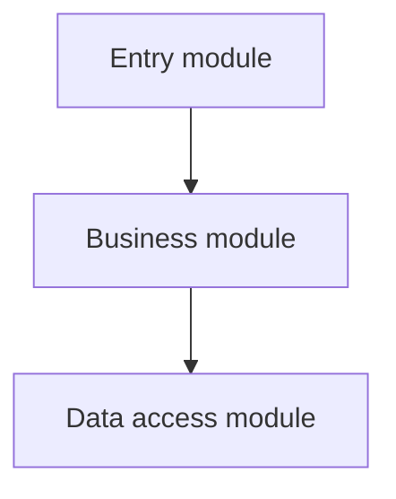
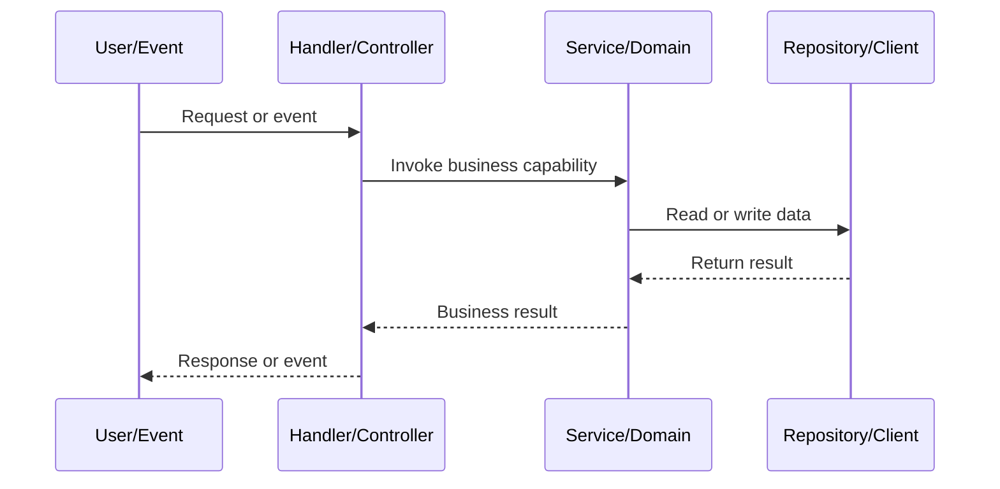

# Project Code Structure Analysis Report

## 1. Project overview
- Project name:
- Project type:
- Primary languages:
- Core frameworks:
- Package manager / build tools:
- Analysis scope:

## 2. Technology stack and infrastructure
| Category | Technology | Evidence file | Purpose |
|---|---|---|---|

## 3. Directory structure
```text
Insert a filtered directory tree
```

| Directory / file | Responsibility | Key notes |
|---|---|---|

## 4. Entry points and runtime boundaries
| Entry point | File / symbol | Initialization or delegation |
|---|---|---|

## 5. Major module responsibilities
| Module | Key files | Responsibility | Dependencies | Output / side effects |
|---|---|---|---|---|

## 6. Module dependencies

> Keep only relationships confirmed by code evidence; label inferred relationships.

## 7. Core business call flow


## 8. Architecture observations and recommendations
| Priority | Finding and evidence | Impact | Recommendation |
|---|---|---|---|

## 9. Unknowns and analysis boundaries
- Uninspected directories / files:
- Uncertainty caused by dynamic calls or runtime configuration:
- Items requiring a running system or additional information:
