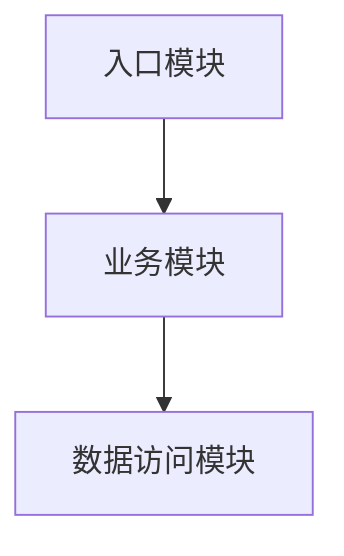
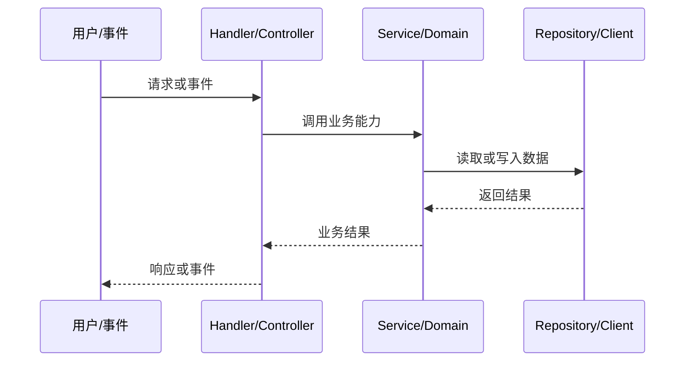

# 项目代码结构分析报告

## 1. 项目概览

- 项目名称：
- 项目类型：
- 主要语言：
- 核心框架：
- 包管理 / 构建工具：
- 分析范围：

## 2. 技术栈与基础设施

| 分类 | 技术 | 证据文件 | 用途 |
|---|---|---|---|

## 3. 目录结构

```text
填写经过筛选的目录树
```

| 目录 / 文件 | 职责 | 关键说明 |
|---|---|---|

## 4. 启动入口与运行边界

| 入口 | 文件 / 符号 | 初始化或委托内容 |
|---|---|---|

## 5. 核心模块职责

| 模块 | 核心文件 | 具体职责 | 依赖对象 | 输出 / 副作用 |
|---|---|---|---|---|

## 6. 模块依赖关系



> 图中只保留有代码证据确认的关系；推测关系必须标注。

## 7. 核心业务调用链



## 8. 架构观察与优化建议

| 优先级 | 发现及证据 | 影响 | 建议 |
|---|---|---|---|

## 9. 未确认事项与分析边界

- 未检查的目录 / 文件：
- 动态调用或运行时配置带来的不确定性：
- 需要启动项目或补充信息才能确认的事项：
